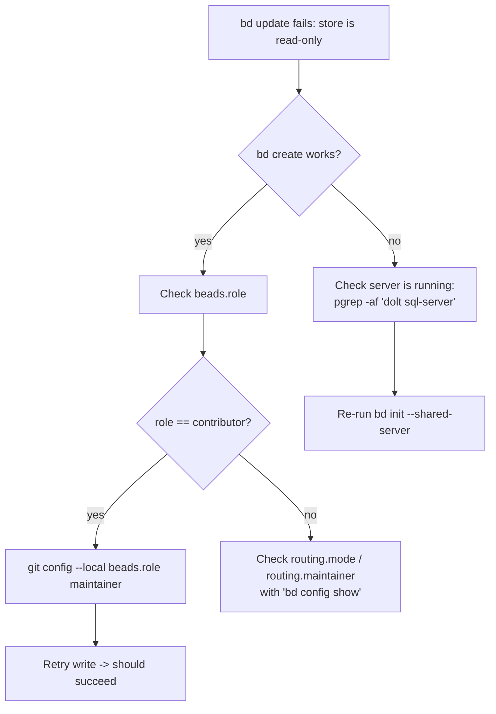

# Running Beads (bd) + Dolt on WSL with Git repos on `/mnt`

This is a recap of the setup and pitfalls for running the **Beads** issue tracker
(`bd`, Dolt-backed) inside **WSL** when the git repository lives on a Windows
drive mounted via DrvFs (e.g. `/mnt/d/...`).

---

## TL;DR

1. **Use shared-server mode** so the Dolt database lives on native Linux ext4
   (`~/.beads/shared-server/`), *not* embedded on `/mnt`. Only tiny config stays
   on `/mnt`.
2. **Set your git role to `maintainer`** so writes route to the server, not to a
   read-only "contributor" store — **this was the actual cause of the
   `store is read-only` error**:
   ```bash
   git config --local beads.role maintainer
   ```
3. Run `bd` **only in the integrated terminal** (no MCP / Copilot-CLI if org policy
   forbids it).

If `bd create` works but `bd update` / `bd dep add` fail with
`embeddeddolt: store is read-only`, jump to [Root cause](#root-cause-the-important-one).

---

## Why shared-server (and *not* embedded) on `/mnt`

We run beads in **shared-server mode on purpose**, so the Dolt database is never
embedded on the Windows drive. In this setup:

- The database lives on native **ext4** at `~/.beads/shared-server/` — served by a
  single Dolt `sql-server`.
- The repo's `.beads/` on `/mnt` holds only config (`metadata.json`,
  `config.yaml`); no Dolt data.

This sidesteps any DrvFs quirks with embedded storage **by design** — because we
never put a writable embedded store on `/mnt` in the first place.

> Note: the `store is read-only` failure we actually hit was **not** a DrvFs
> problem — it was routing (see [Root cause](#root-cause-the-important-one)). The
> one real `/mnt` annoyance that remains is the cosmetic permissions warning
> (`.beads has permissions 0777`), because `chmod` doesn't stick on DrvFs; it is
> harmless and can be filtered.

---

## One-time setup

### 1. Install a Linux `dolt` binary

Shared-server mode needs an external `dolt` binary on `PATH`:

```bash
curl -fsSL https://github.com/dolthub/dolt/releases/latest/download/dolt-linux-amd64.tar.gz \
  | tar -xz -C /tmp
cp -f /tmp/dolt-linux-amd64/bin/dolt ~/.local/bin/
hash -r
dolt version   # expect: dolt version 2.x.x
```

Make sure `~/.local/bin` is on your `PATH`.

### 2. Initialize beads in shared-server mode

From the repo root on `/mnt`:

```bash
cd /mnt/d/github/<your-repo>
bd init --prefix <prefix> --shared-server --stealth --non-interactive
```

- `--shared-server` — runs a single Dolt `sql-server` under
  `~/.beads/shared-server/` (native ext4), shared across all projects. The
  workspace `.beads/` holds only config (`metadata.json` has `dolt_mode: server`).
- `--stealth` — keeps beads invisible to collaborators by configuring
  `.git/info/exclude` (nothing is committed).
- `--non-interactive` — skips the wizard and sets the role to maintainer during
  init.

### 3. Set the git role to `maintainer` (critical)

```bash
git config --local beads.role maintainer
git config --local --get beads.role   # -> maintainer
```

See below for why this matters.

### 4. Verify writes work

```bash
ID=$(bd create "smoke test" | grep -oE '<prefix>-[a-z0-9]+' | head -1)
bd update "$ID" -p 1        # must print: ✓ Updated issue
bd delete "$ID" --force
```

---

## Root cause (the important one)

The `embeddeddolt: store is read-only` error is usually **not** the DrvFs bug —
it's a **routing** misconfiguration.

`.git/config` can contain:

```ini
[beads]
    role = contributor
```

With `routing.mode = auto`, the **contributor** role routes every write to
`routing.contributor` — which points at a personal planning repo
(e.g. `~/.beads-planning`) whose embedded Dolt store is opened **read-only** for
hydration. Result:

| Operation | Routed to | Outcome |
| --- | --- | --- |
| `bd create` (INSERT) | primary / server | works |
| `bd update`, `bd dep add` (UPDATE) | read-only contributor store | `store is read-only` |

Switching the role to `maintainer` routes writes to `routing.maintainer = "."`
(the shared server), and all mutations succeed.

Check current routing with:

```bash
bd config show | grep -E 'beads.role|routing.mode|routing.maintainer|routing.contributor'
```

---

## Operational notes & gotchas

- **Beads are local-only.** `.beads/` is git-excluded via `.git/info/exclude` and
  is never committed. There is nothing to "publish"; only your code is a git
  handoff. `bd dolt push` is not needed for solo/local use.
- **Do not symlink `.beads`.** bd resolves its repo root from a real `.beads`
  directory inside the repo; a symlink breaks resolution
  (`no beads configuration found ...`).
- **`bd doctor --fix` hangs** on an interactive prompt in non-interactive shells.
  Use plain `bd doctor` to diagnose; apply fixes manually.
- **Harmless permissions warning.** You will see
  `.beads has permissions 0777 (recommended: 0700)`. `chmod` won't stick on DrvFs.
  Filter it in scripts:
  ```bash
  bd list 2>&1 | grep -v 'permissions 0777\|chmod 700'
  ```
- **`bd init` re-adds `repos.additional: ~/.beads-planning`** to
  `.beads/config.yaml`. It is harmless once `role = maintainer`, but you may remove
  the `repos:` block from `.beads/config.yaml` to keep things clean.
- **Run `bd` in the integrated terminal only** if org policy forbids MCP /
  Copilot-CLI access to the tracker.
- **Non-interactive shell hygiene.** On WSL, `cp`/`mv`/`rm` may be aliased to `-i`.
  Use `-f` / `rm -rf` to avoid hangs on confirmation prompts.

---

## Quick diagnosis flowchart



---

## Recovery: full clean reinstall

If the store is in a bad state, wipe and reinitialize (preserve any real planning
repo such as `~/.beads-planning`):

```bash
# Stop server and remove all beads/dolt state
bd server stop 2>/dev/null; pkill -f 'dolt sql-server'
rm -rf ~/.beads ~/.beads-stores
rm -rf /mnt/d/github/<your-repo>/.beads

# Reinstall shared-server mode
cd /mnt/d/github/<your-repo>
bd init --prefix <prefix> --shared-server --stealth --non-interactive
git config --local beads.role maintainer

# Verify
bd create "smoke" && bd list
```
